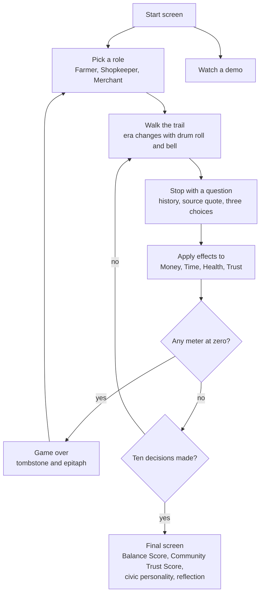
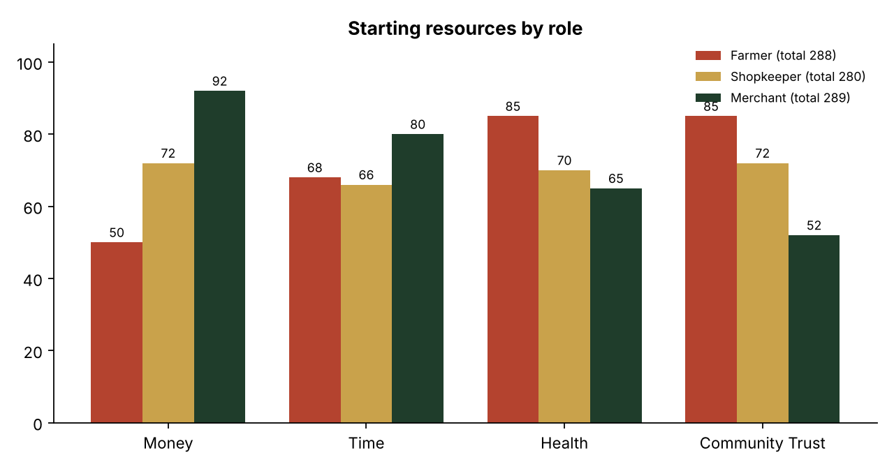
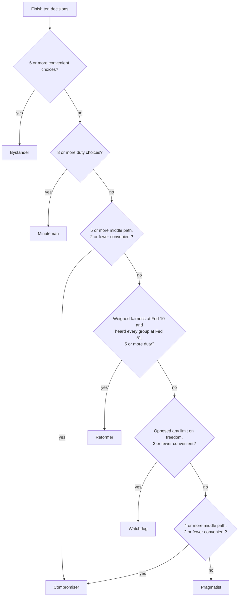

# Personal Duty

**[Play it in your browser](https://anaygoyal7878-del.github.io/personal-duty/)** · [Watch the demo](https://anaygoyal7878-del.github.io/personal-duty/?demo)

A pixel art side scrolling history game about the civic virtue of personal duty, from the founding era to today. Made for APUSH and AP Lang. The theme is the mutual pledge at the end of the Declaration of Independence, where the signers pledged their lives, fortunes and sacred honor. In the game you spend what they pledged: your health, your money, your time and your community's trust.

Everything is in one file, `index.html`. There is no build step and nothing to install.

## How the game plays

You pick a role, then walk along a trail through six historical parts. At ten stops, from Q1 to Q10, the story pauses on a question about a duty you owe your community. Every choice moves four meters and is tagged by what kind of choice it was.

## The four meters

Each meter stays between 0 and 100. If any one hits zero the journey ends with its own epitaph: spent every last coin, gave every hour away, wore themselves out, or lost the town's trust. Protecting yourself every time is not safe either, because trust drains when you keep choosing convenience.

## Three roles

Starting totals are nearly equal, so every role can win and every role can lose. What differs is where the strength and the weakness sit, based on colonial life.

| Role | Strength | Pressure |
|---|---|---|
| Farmer | Strong and trusted by neighbors | Very little cash |
| Shopkeeper | Balanced | The whole town depends on long shop hours |
| Merchant | Wealthy, clerks free up time | Watched closely during the boycotts, so less trust |

## The ten decisions

Each decision shows the history of the moment, the choices, and a primary source quote with a link. Choices are tagged duty, middle path or convenience. Sources include the Constitution's Preamble and Madison's Federalist Nos. 10, 51 and 55.

| # | Stop | Era |
|---|---|---|
| 1 | Your Community Needs You | Colonial countryside, 1774 |
| 2 | Patrick Henry | Colonial town, 1775 |
| 3 | Common Sense | Colonial town, 1775 |
| 4 | The Declaration | Revolutionary community, 1776 |
| 5 | Building the New Government | Founding era, 1787 |
| 6 | Federalist 10 | Founding era, 1787 |
| 7 | Federalist 51 | Constitutional debate, 1788 |
| 8 | Rights and Responsibilities | Constitutional debate, 1788 to 1791 |
| 9 | Should I Vote? | Today |
| 10 | Jury Service | Today |

## Civic personality

At the end the game checks your choices against rules in order and uses the first that fits.

Two scores are shown: a Balance Score, the average of Money, Time, Health and Community Trust, and a Community Trust Score. Neither says whether you are a good citizen. Together they show the tradeoffs you made.

## Craft

- **Pixel art generated in code.** Scenery, characters, outfits by era, vehicles by era and drifting particles (pollen, autumn leaves, paper scraps) are all drawn on canvas.
- **Sound with no audio files.** A drum roll and bell for each new era, a chime for today, and effects for choices are made live with the Web Audio API.
- **Demo mode.** About three and a half minutes of the game playing itself, started with `?demo` or the button on the start screen.
- **Content in one object.** All text, choices, sources and effects live in a `GAME` object at the top of the file, so a teacher can change the content without touching the engine.
- **Responsive.** Layout and the era tick marks adapt to small screens.

## Deploy

It is a single static HTML file, so any static host works. This repo is served with GitHub Pages from `main`.

## Files

- `index.html`: the whole game
- `docs/images/`: charts used in this README
